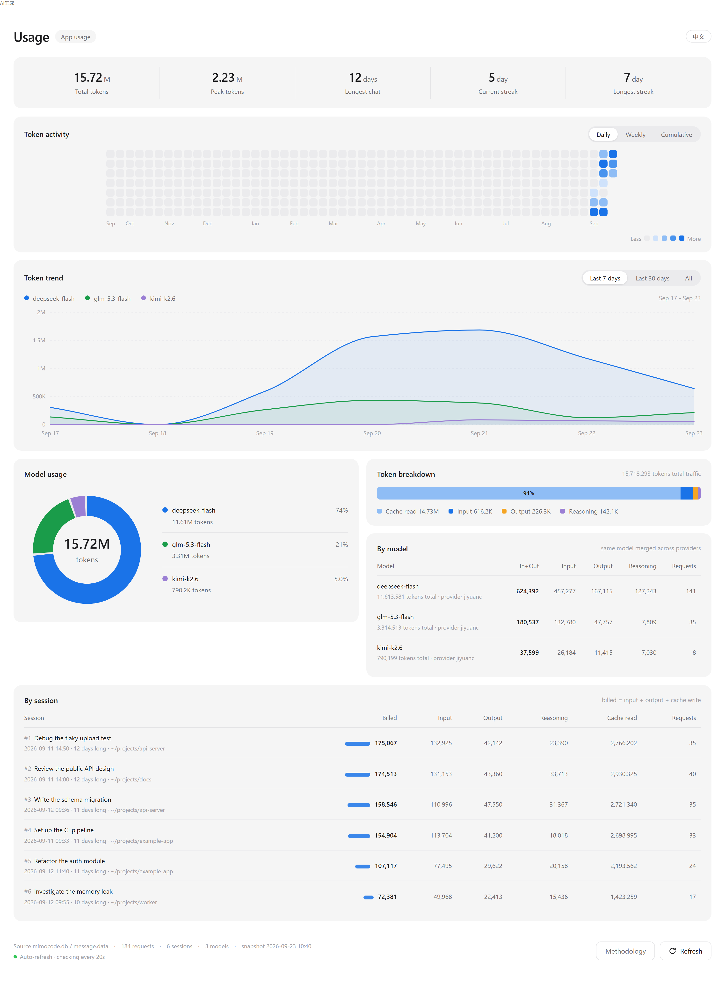

# MiMo Token Usage Dashboard

**English** · [中文](README.zh-CN.md)

A local dashboard for the token usage that MiMo Desktop never shows you.

MiMo Desktop keeps no history of what you have spent — there is only a context-window
ring beside the composer. The numbers *are* on your machine though, in the engine's
SQLite database. This reads that database and renders a dashboard from it, entirely
offline.



## What you get

- **Overview row** — total tokens, peak day, longest chat, current and longest streak.
- **Activity calendar** — a year of usage as a heatmap, switchable between daily,
  weekly and cumulative views.
- **Trend chart** — one smooth series per model, over the last 7 / 30 days or all time.
- **Model breakdown** — a donut plus a table, with same-named models merged across
  providers.
- **Detail tables** — per session and per model, with hover tooltips giving the full
  figures behind every row and cell.
- **Auto-refresh** — once the watcher is running, the page re-reads the data every
  20 seconds. No manual refresh.
- **Bilingual** — Chinese and English, picked from your browser language and switchable
  from the header.

Everything runs locally. The page makes no network requests, and nothing leaves your
machine.

## Requirements

- MiMo Desktop, run at least once (so a database exists).
- Python 3.8+ **with the `sqlite3` module** — the standard library build has it. If you
  have no Python of your own, the launcher will find the runtime MiMo Desktop bundles;
  you normally do not need to install anything.

No third-party packages. Nothing to `pip install`.

## Quick start

**Windows** — double-click `start.cmd`.

**macOS / Linux**

```sh
./start.sh
```

Either one refreshes the data, starts a background watcher, and opens the dashboard in
your browser. To stop the watcher, run `stop.cmd` / `./stop.sh` (or close its window on
Windows if you started it that way).

Prefer no background process? Export once and open the page yourself:

```sh
python3 export_tokens.py      # writes data.js
```

Then open `index.html`. The page will show that snapshot; use the **Refresh** button
after re-running the export.

## How the numbers are computed

These matter, because two different token totals appear on the page and they are not
comparable:

| Measure | What it counts | Where it appears |
|---|---|---|
| **All tokens** | input + output + reasoning + cache read + cache write | overview row, donut, trend chart |
| **Billed** | input + output + cache write | the `Billed` column in both tables |

Cache reads are broken out separately because they are usually billed at a heavy
discount. Folding them into the headline total would hide the real cost structure —
they are often 90%+ of all traffic.

Other things worth knowing:

- **No money is shown, on purpose.** The database has a `cost` field, but MiMo Desktop
  writes `0` into it, always. Any spend figure derived from it would be fiction. For
  actual billing, see your MiMo account usage page.
- **Models are merged by model ID.** The same model reached through two providers
  (e.g. `jiyuanc/deepseek-flash` and `jiyuan/deepseek-flash`) is one model, not two.
  The providers actually seen are listed in the table.
- **Streaks** count consecutive calendar days with usage. A current streak of `0` means
  nothing has been spent today yet.
- **Longest chat** is the span between the first and last message in a session, not how
  long the model spent generating.

The **Methodology** button in the page footer repeats all of this in the UI.

## Configuration

The database is auto-detected. It looks in, in order:

1. `$MIMO_DB`, if set
2. `$XDG_DATA_HOME/mimocode/mimocode.db` (or `~/.local/share/mimocode/mimocode.db`)
3. `~/Library/Application Support/mimocode/mimocode.db` (macOS)
4. `%APPDATA%\Xiaomi MiMo\mimocode\mimocode.db` and similar (Windows)

Check what it found, or point it somewhere else:

```sh
python3 export_tokens.py --print-db
python3 export_tokens.py --db /path/to/mimocode.db
MIMO_DB=/path/to/mimocode.db ./start.sh
```

The watcher takes the same options:

```sh
python3 watch_tokens.py --interval 3     # poll faster than the default 3s
python3 watch_tokens.py --min-gap 30     # export at most every 30s
python3 watch_tokens.py --status         # is a watcher running?
python3 watch_tokens.py --stop           # stop it
```

## Files

```
index.html          dashboard entry point
app.js              rendering: charts, tables, tooltips, layout
i18n.js             Chinese and English strings
styles.css          styling
data.js             generated — your usage snapshot (gitignored)
export_tokens.py    reads mimocode.db, writes data.js
watch_tokens.py     keeps data.js current
start.cmd / .sh     launch (Windows / macOS+Linux)
stop.cmd  / .sh     stop the watcher
find-python.cmd/.sh shared Python discovery, used by the launchers
make_demo_data.py   builds an invented snapshot, for screenshots and testing
docs/               README screenshots
```

To preview the UI without touching your own data:

```sh
python3 make_demo_data.py     # writes a demo data.js
# ...look at it, then re-run export_tokens.py to restore your real numbers
```

## Troubleshooting

**"Python 3 was not found."**
Install Python 3, or point `MIMO_PYTHON` at an interpreter:
`MIMO_PYTHON=/usr/bin/python3 ./start.sh`.

**"Could not find mimocode.db."**
Run MiMo Desktop at least once first. If your data lives somewhere unusual, pass
`--db PATH` or set `MIMO_DB`.

**The page shows no data.**
`data.js` has not been generated yet. Run `python3 export_tokens.py`, then press
**Refresh**.

**Refresh says it cannot read data.js.**
On a `file://` page the browser blocks `fetch`, and the fallback can fail if the file
is cached. Reload the page with Ctrl+R / Cmd+R instead.

**Numbers look stale.**
The page shows the snapshot from the last export. Either keep `watch_tokens.py`
running, or re-run the export and hit **Refresh**.

**The layout is a single column.**
Two columns start at a 1200px-wide window. Below that, one full-width column is roomier
than two cramped ones.

## Compatibility

Built and tested against MiMo Desktop `26.922.222056` on Windows. The database schema
and the message payload have both changed across MiMo releases, so the reader treats
every field as optional: unknown fields are ignored, rows that fail to parse are
skipped (and counted in the console output), and a missing table produces a clear error
rather than a traceback.

The dashboard itself is plain HTML/CSS/JS with no build step and no dependencies, and
works in any current Chromium, Firefox or Safari.

## Privacy

Everything stays on your machine. The database is read through a temporary copy, so a
running MiMo Desktop never sees a lock or a write. `data.js` contains your session
titles and working directories, which is why it is gitignored — check before sharing
it.

## License

[MIT](LICENSE)
