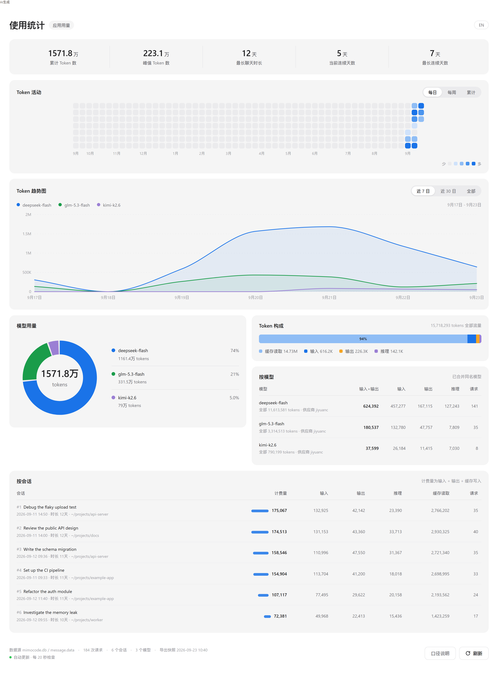

# MiMo Token 用量看板

[English](README.md) · **中文**

一个本地看板，用来查看 MiMo Desktop 从不展示的 token 用量。

MiMo Desktop 没有历史用量入口——输入框旁边只有一个上下文占用环。但数据其实就在你机器上，
存在引擎的 SQLite 数据库里。这个工具直接读取该数据库并渲染成看板，全程离线。



## 包含什么

- **概览行** —— 累计 token、峰值日、最长聊天、当前与最长连续天数。
- **活动日历** —— 整年用量热力图，可在每日 / 每周 / 累计三种口径间切换。
- **趋势图** —— 每个模型一条平滑曲线，可选近 7 日 / 近 30 日 / 全部。
- **模型构成** —— 环形图加明细表，同名模型跨供应商合并。
- **明细表** —— 按会话与按模型，鼠标悬停在每一行、每一个格子上都会显示完整数据。
- **自动更新** —— 监听脚本运行后，页面每 20 秒自动拉取一次，无需手动刷新。
- **中英双语** —— 按浏览器语言自动选择，也可在页头手动切换。

全部在本地运行。页面不发起任何网络请求，数据不会离开你的机器。

## 环境要求

- MiMo Desktop，且至少运行过一次（这样数据库才会存在）。
- Python 3.8+，**需带 `sqlite3` 模块**（标准发行版自带）。如果你自己没有 Python，
  启动脚本会自动找到 MiMo Desktop 内置的运行时，通常不需要额外安装任何东西。

无第三方依赖，不需要 `pip install`。

## 快速开始

**Windows** —— 双击 `start.cmd`。

**macOS / Linux**

```sh
./start.sh
```

两者都会：刷新数据 → 后台启动监听 → 在浏览器打开看板。停止监听请运行
`stop.cmd` / `./stop.sh`。

不想常驻后台进程？只导出一次，自己打开页面：

```sh
python3 export_tokens.py      # 生成 data.js
```

然后打开 `index.html`。页面会显示该快照；重新导出后点页面上的**刷新**按钮即可。

## 数字是怎么算的

这部分值得一读，因为页面上有**两个不同的 token 口径**，它们不可直接比较：

| 口径 | 包含 | 出现位置 |
|---|---|---|
| **全部 Token** | 输入 + 输出 + 推理 + 缓存读取 + 缓存写入 | 概览行、环形图、趋势图 |
| **计费量** | 输入 + 输出 + 缓存写入 | 两张表的「计费量」列 |

缓存读取单独列出，是因为它通常按大幅折扣计价，往往占全部流量的 90% 以上；把它混入总量
会掩盖真实的成本结构。

其他需要知道的：

- **不显示金额，这是刻意的。** 数据库里有 `cost` 字段，但 MiMo Desktop 写入的永远是 `0`。
  据此换算出的任何费用都是虚构的。要看实际账单请前往 MiMo 账户用量页面。
- **模型按模型 ID 合并。** 同一个模型经由两个供应商调用（例如 `jiyuanc/deepseek-flash`
  与 `jiyuan/deepseek-flash`）算作一个模型，而不是两个。实际用到的供应商会列在表格里。
- **连续天数**按有消耗的自然日计算；当前连续天数为 `0` 表示今天还没有产生用量。
- **最长聊天时长**是单个会话内首条与末条消息的时间跨度，不是模型的生成耗时。

页面底部的**口径说明**按钮会在界面里重复以上内容。

## 配置

数据库路径自动探测，依次查找：

1. `$MIMO_DB`（若已设置）
2. `$XDG_DATA_HOME/mimocode/mimocode.db`（或 `~/.local/share/mimocode/mimocode.db`）
3. `~/Library/Application Support/mimocode/mimocode.db`（macOS）
4. `%APPDATA%\Xiaomi MiMo\mimocode\mimocode.db` 等（Windows）

查看探测结果，或指定其他位置：

```sh
python3 export_tokens.py --print-db
python3 export_tokens.py --db /path/to/mimocode.db
MIMO_DB=/path/to/mimocode.db ./start.sh
```

监听脚本支持同样的参数：

```sh
python3 watch_tokens.py --interval 3     # 比默认 3 秒更频繁地检查
python3 watch_tokens.py --min-gap 30     # 最多每 30 秒导出一次
python3 watch_tokens.py --status         # 监听是否在运行？
python3 watch_tokens.py --stop           # 停止监听
```

## 文件说明

```
index.html          看板入口
app.js              渲染：图表、表格、悬停浮层、布局
i18n.js             中英文字符串
styles.css          样式
data.js             生成产物 —— 你的用量快照（已 gitignore）
export_tokens.py    读取 mimocode.db，生成 data.js
watch_tokens.py     让 data.js 保持最新
start.cmd / .sh     启动（Windows / macOS+Linux）
stop.cmd  / .sh     停止监听
find-python.cmd/.sh 共用的 Python 探测逻辑，供启动脚本调用
make_demo_data.py   生成一份虚构的快照，用于截图和测试
docs/               README 配图
```

想在不碰自己数据的前提下预览界面：

```sh
python3 make_demo_data.py     # 写入一份演示用的 data.js
# ……看完后重新运行 export_tokens.py 即可恢复真实数据
```

## 常见问题

**提示「Python 3 was not found」。**
安装 Python 3，或把 `MIMO_PYTHON` 指向解释器：
`MIMO_PYTHON=/usr/bin/python3 ./start.sh`。

**提示「Could not find mimocode.db」。**
先运行一次 MiMo Desktop。若数据在非常规位置，用 `--db PATH` 或设置 `MIMO_DB`。

**页面没有数据。**
`data.js` 还没生成。运行 `python3 export_tokens.py`，然后点**刷新**。

**刷新提示无法读取 data.js。**
在 `file://` 页面下浏览器会拦截 `fetch`，回退路径也可能因文件被缓存而失败。直接用
Ctrl+R / Cmd+R 重新载入页面即可。

**数字看起来是旧的。**
页面显示的是上次导出时的快照。要么保持 `watch_tokens.py` 常驻，要么重新导出后点**刷新**。

**布局只有一列。**
双列在窗口宽度达到 1200px 时启用。低于这个宽度，一整列通栏比两列挤在一起更好读。

## 兼容性

在 Windows 上针对 MiMo Desktop `26.922.222056` 开发与测试。数据库结构和消息负载在
MiMo 的不同版本间都变过，所以读取端把每个字段都当作可选的：未知字段忽略，解析失败的行
跳过（并在控制台输出中计数），缺少数据表时给出明确报错而不是堆栈。

看板本身是纯 HTML/CSS/JS，无构建步骤、无依赖，可在任何较新的 Chromium、Firefox、
Safari 中运行。

## 隐私

一切都在你机器上。数据库通过临时副本读取，运行中的 MiMo Desktop 不会遇到锁或写入。
`data.js` 里含你的会话标题与工作目录，因此已被 gitignore —— 分享前请先检查。

## 许可

[MIT](LICENSE)
